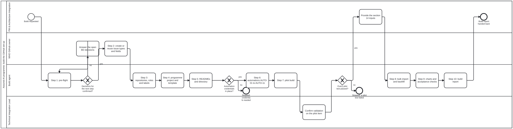

# Processes

The Assured AI programme's processes, as BPMN. Each diagram says who does each step and where the work must stop. The diagram is the authority; the `.checklist.md` beside it is generated from it.

| Diagram | What it covers |
|---|---|
| [`process/programme-build.bpmn`](process/programme-build.bpmn) ([checklist](process/programme-build.checklist.md)) | The build sequence in section 13 of the programme requirements: pre-flight, organisation set-up, repositories, projects, READMEs, automations, pilot, bulk import, charts and the build report. It stops when a decision or the automation credentials are missing, or a pilot test fails |

The picture is drawn from the diagram; regenerate it when the diagram changes.

Lanes are roles: PM & Architecture Integration, WHO GitHub owner, Build agent and Technical Integration Lead.
